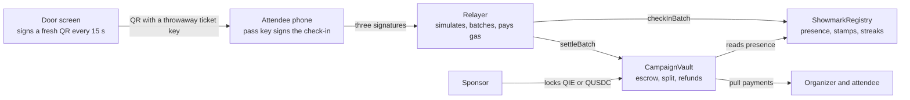

# Showmark

Sponsors pay only for people who actually show up.

A sponsor locks a budget in escrow on QIE. An organizer runs a real event with a door screen that shows a signed QR code. Each attendee checks in from their phone with no wallet and no gas, and gets a soulbound stamp in a passport. The moment that presence is recorded on chain, the escrow pays the agreed amount, split between the organizer and the attendee. Whatever is not earned goes back to the sponsor. Every number a sponsor used to take on trust (headcount, reach, real people) becomes a transaction they can open on the explorer.

**Live app:** https://showmark.vercel.app
**Traction, read from the chain:** https://showmark.vercel.app/traction
**Docs:** https://showmark.vercel.app/docs

## Try it in one minute

1. Open the Judges' desk link on the landing page (or scan the door code at our demo) with your phone camera.
2. The page opens, creates a pass on your phone, and checks you in. Your stamp lands in about 8 seconds, with a link to the transaction.
3. Tap "Open my passport" to see the stamp and the reward it earned. Link QIE Wallet when you want to withdraw.

No wallet, no gas and no sign-up are needed to check in. The relayer pays the network fee.

## How it works



Recording presence and moving money are separate transactions on separate contracts, so no campaign problem can ever stop a person from checking in. Read [docs/ARCHITECTURE.md](docs/ARCHITECTURE.md) for the full design and [docs/SECURITY.md](docs/SECURITY.md) for the threat model, including what the rotating QR cannot prevent.

## QIE integrations

| QIE component | What it does in Showmark | Where |
|---|---|---|
| QIE Mainnet (chain 1990) | All contracts, every check-in and payout | `packages/contracts/src` |
| Native QIE | Default escrow token and the organizer bond | `CampaignVault.sol`, `OrganizerBond.sol` |
| QUSDC | Stable escrow for sponsors who budget in dollars | `CampaignVault.sol`, sponsor console |
| QIE Wallet | First-class wallet: EIP-6963 discovery by `me.qiewallet`, fallback `window.qie`, sign-in, linking a pass, withdrawing | `apps/web/src/lib/wallet` |
| QIE ID names | Campaigns can pay only attendees whose linked wallet holds a `.qie` name; names show across the app | `QieIdCheck.sol`, `apps/web/src/server/qie` |
| QIE/USDT oracle | Budgets set in dollars and paid in QIE at the price at settlement; a stale price defers payment instead of mispricing it | `CampaignVault.sol` |
| QIEDEX | Fund a QUSDC campaign from QIE through the router, with price impact shown | `apps/web/src/app/(sponsor)`, `/api/dex/quote` |
| Safe on safe.qie.digital | Owns every contract; the sponsor console runs as a Safe App so a treasury can fund campaigns | `script/Deploy.s.sol`, `apps/web/src/app/(sponsor)/sponsor/manifest.json` |
| QIE Explorer (Blockscout) | Every contract is source-verified; every stamp and payout links to it | `script/verify.sh` |

## Contracts

All contracts are original, immutable (no proxies) and owned by the protocol Safe.

### QIE Mainnet

Deployment pending. Addresses will be listed here with explorer links.

### QIE Testnet (chain 1983), source-verified

| Contract | Address |
|---|---|
| ShowmarkRegistry | [0xb97517a6Ab3E097a894949793Cf478c7C2485032](https://testnet.qie.digital/address/0xb97517a6Ab3E097a894949793Cf478c7C2485032) |
| PresenceStamp | [0x5104d466fbeFcA6062672C8Fd61AA45c48635818](https://testnet.qie.digital/address/0x5104d466fbeFcA6062672C8Fd61AA45c48635818) |
| CampaignVault | [0xb772A3786AD2b65eB648cE2eEf205Dc4F4Dc18b1](https://testnet.qie.digital/address/0xb772A3786AD2b65eB648cE2eEf205Dc4F4Dc18b1) |
| OrganizerBond | [0xC741Fd300f72b340BeE933b9BD09F68E589f56f5](https://testnet.qie.digital/address/0xC741Fd300f72b340BeE933b9BD09F68E589f56f5) |
| PresenceLens | [0x496c7D21B1Ec6A303e822Ca486D602Cb352D8050](https://testnet.qie.digital/address/0x496c7D21B1Ec6A303e822Ca486D602Cb352D8050) |

## Security

- 238 Foundry tests with 100 percent line and branch coverage, including fuzz tests and a handler-based invariant suite that proves escrow solvency, one presence per person per event, and that refunds and withdrawals always work, even while paused.
- An independent review by a separate agent that did not write the contracts, over four rounds. Every finding and its fix is in [packages/contracts/docs/AUDIT.md](packages/contracts/docs/AUDIT.md), and each exploit is kept as a regression test.
- Slither results with a justification for each in [packages/contracts/docs/slither.md](packages/contracts/docs/slither.md).

## For builders

- **TypeScript SDK** `@showmark/sdk`: read presence, sign check-ins, render a rotating door QR or a check-in button in React. See [docs/SDK.md](docs/SDK.md).
- **`IPresence`**: any QIE contract can gate on real-world presence with one call. Example: `packages/contracts/src/examples/PresenceGatedMint.sol`.
- **MCP server**: agents can query verified reach and campaigns next to the QIE Wallet MCP:
  `claude mcp add --transport http showmark https://showmark.vercel.app/api/mcp`

## Repository

```
apps/web            Next.js app: landing, attendee app, organizer console and door screen, sponsor console, API, relayer, indexer
packages/contracts  Foundry project: contracts, tests, audit regressions, deploy and verify scripts
packages/sdk        @showmark/sdk and React components
packages/mcp        read-only MCP server
docs                architecture, security, decisions, evidence, launch kit
```

Run it locally:

```
pnpm install
pnpm --filter "web..." build
cd packages/contracts && forge test
```

## Traction

Live numbers are on [/traction](https://showmark.vercel.app/traction), read straight from the chain, with team-funded pools and outside sponsors shown separately.

## Team

To be filled in with names, roles and who owns which area.

## How it was built

Showmark was built during QIE Hackathon 3.0 by the team with AI-assisted development, which the hackathon FAQ allows. Every architectural decision is recorded with its reason in [docs/DECISIONS.md](docs/DECISIONS.md), every claim of "it works" has its proof in [docs/EVIDENCE.md](docs/EVIDENCE.md), and the commit history shows the build step by step.
