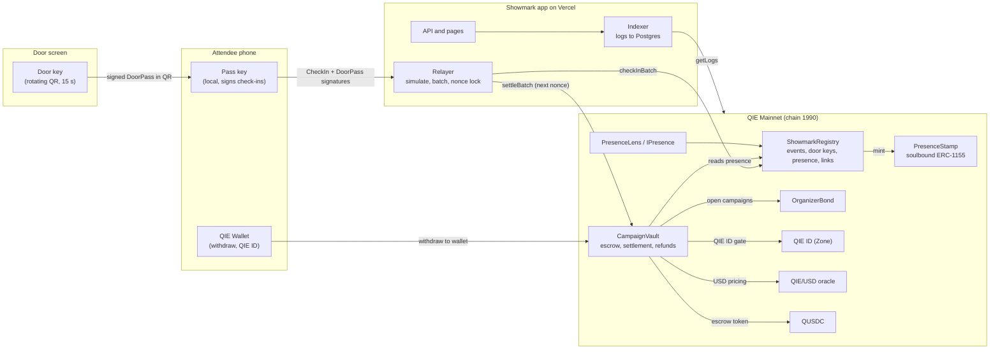

# Architecture

Showmark turns "people showed up" into a transaction a sponsor can open on the explorer. A sponsor locks a budget in escrow, an organizer runs a real event with a signed door, an attendee checks in from their phone, and each verified presence pays the organizer and the attendee from that escrow. Whatever is not earned goes back to the sponsor.

## The pieces

## Check-in, step by step

1. The organizer creates an event on the registry and authorizes a door key for it. The door key is generated in the door screen's browser and lives only there.
2. Every 15 seconds the door screen signs `DoorPass(eventId, issuedAt)` and shows it as a QR code that is a plain URL, so any phone camera opens it.
3. The attendee's phone opens `/c/{token}`. If this is their first time, the app creates a pass key locally. The pass signs `CheckIn(eventId, attendee)`. No wallet popup and no gas.
4. The app posts both signatures to `/api/relay/check-in`. The relayer simulates the call, takes the nonce lock, batches whatever check-ins are waiting, and sends `checkInBatch` to the registry.
5. The registry checks both signatures against its EIP-712 domain, the door key's authorization window, freshness against block time, the event window and capacity, then records presence once, updates the streak and mints a soulbound stamp.
6. With the next nonce, the relayer sends `settleBatch` to the vault for every campaign that pays for this event. Each settlement either pays (attendee share, organizer share, protocol fee, all as pull-payment balances) or is skipped with a status code. Both transactions usually land in the same block, about 3.6 seconds.
7. The attendee sees the stamp press as soon as the check-in transaction is mined. Later they link QIE Wallet once and withdraw.

Recording presence and moving money are separate transactions on separate contracts. The registry never calls the vault, so no campaign problem (paused vault, empty budget, stale oracle) can ever stop a person from being checked in.

## Proof modes

| Mode | How | What it proves | Weakness |
|---|---|---|---|
| 1. Rotating door QR | Door signs a fresh pass every 15 s; the chain rejects passes older than the event's `maxPassAge` | Someone scanned a code shown at the door within the last minute or so | A person at the door could stream the screen to someone outside. Sponsors who care pick mode 2 |
| 2. Door scans you | Staff scan the attendee's code; the door key signs an attestation bound to that attendee address | A specific pass was physically in front of the door staff | Requires staff with a phone or laptop. Works offline: attestations queue and are submitted later |

Campaigns set `minProofMode`, so a sponsor decides how strong the proof must be before money moves.

## Identity

- **Pass**: a local key in the browser that signs check-ins. It never needs gas and never holds funds.
- **Wallet**: the attendee's QIE Wallet, linked to the pass once with signatures from both. Linking is one-to-one, so one wallet cannot collect QIE-ID-gated rewards through many passes.
- **QIE ID**: a `.qie` name in the Zone contract. A campaign can require that the linked wallet holds one before it pays. Settlement is retryable, so linking later still pays out within the grace period.

## Money

- Escrow per campaign in native QIE or QUSDC. Deposits are credited by the actual balance change.
- Pricing is either a fixed token amount per presence, or a USD amount paid in native QIE at the oracle price at settlement time. A stale or non-positive price defers settlement instead of mispricing it.
- Payout split: protocol fee first (hard cap 5 percent, snapshotted per campaign), then the attendee share, then the organizer gets the rest.
- Everyone is paid by pull: settlement credits balances, and `withdraw` sends them. Refunds of unspent escrow open three days after the campaign ends, and neither refund nor withdraw can be paused.

## Off-chain parts

- **Relayer** (`apps/web/src/server/relayer`): signs with a dedicated relayer key, relays only to our two contracts, simulates first, serializes nonces with a Redis lock and micro-batches check-ins.
- **Indexer** (`apps/web/src/server/indexer`): reads logs with failover across the five public RPC endpoints and stores them in Postgres. It catches up whenever a page reads, so it does not depend on a paid scheduler.
- **API and pages** (`apps/web/src/app`): Next.js on Vercel. Anything about money or presence comes from the chain through the indexer. Off-chain data is limited to report caches and the offline door queue.
- **SDK** (`packages/sdk`) and **MCP server** (`packages/mcp`, also at `/api/mcp`): the same reads and signing helpers for other builders and for AI agents.

## Contracts

| Contract | Role |
|---|---|
| `ShowmarkRegistry` | Series, events, door keys, check-ins (single and batched), streaks, pass to wallet links |
| `PresenceStamp` | Soulbound ERC-1155, one token id per event, minted by the registry |
| `CampaignVault` | Sponsor escrow, event approvals, settlement, splits, fee, oracle pricing, refunds, withdrawals |
| `OrganizerBond` | Organizer stake, sponsor challenges, slashing by the protocol Safe |
| `PresenceLens` | `IPresence` implementation so any QIE contract can gate on real-world presence |

All contracts are immutable. Owner powers (pause, fee within the cap, stamp metadata URL, arbitration) belong to a Safe on safe.qie.digital.
